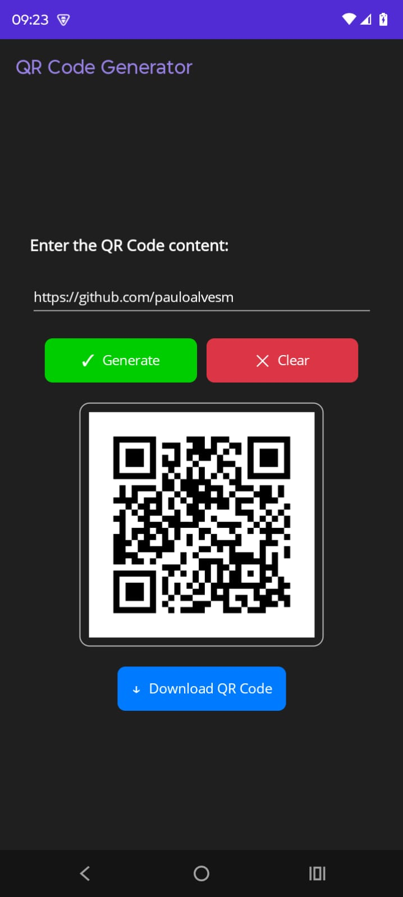

<h1 align="center">QR Code Generator</h1>

<p align="center">
  <a href="https://learn.microsoft.com/pt-br/dotnet/"></a>
  <a href="https://learn.microsoft.com/pt-br/dotnet/csharp/programming-guide/"></a>
</p>

## 💻 Project

Repository with a mobile app for generating QR codes, this application connects to the project
[dotnet-qr-code-generator-api](https://github.com/pauloalvesm/dotnet-qr-code-generator-api). 

## 📘 Business Rule

- Users can enter the text they want to convert into a QR Code in an input field.
- After the QR Code is generated, a download option is available.
- Users can also clear the text field and the generated image to make a new request.

## 🚀 Technologies and Tools

This project was developed using the following technologies:

- **Backend:**  
  - `.NET 10`
  - `.NET MAUI`
  - `C#`
  - `XUnit`
 
## 💾 How to Run Locally

```bash
# Clone the repository
git clone https://github.com/pauloalvesm/dotnet-maui-qr-code-generator.git

# Navigate to the project folder
cd src/QRCodeGenerator.App

# Restore the dependencies
dotnet restore

# Run the project
dotnet run
```

## 📷 Screenshot

<p align="center">  </p>

## 👤 Author

**[Paulo Alves](https://github.com/pauloalvesm)**
